  

  
  

Profissional de Tecnologia da Informação em formação, cursando Análise e Desenvolvimento de Sistemas na Fatec Taquaritinga. Tenho experiência prática em soluções de Business Intelligence (Power BI, SQL, DAX) e no desenvolvimento de software e aplicações web (Python, Angular, C#). Busco criar arquiteturas eficientes, automatizar processos e transformar dados em informações estratégicas.

## Sobre mim

| | |
|---|---|
| **Foco** | Desenvolvimento Full-Stack e Análise de Dados/BI |
| **Atuação atual** | Desenvolvedor na Baldan Agro: indicadores de BI, processos de ETL, automações corporativas (Python, Power Automate) e aplicações em Angular, Python e C# |
| **Formação** | Tecnólogo em Análise e Desenvolvimento de Sistemas (Fatec) e Técnico em Desenvolvimento de Sistemas (Etec) |
| **Interesses** | Integração de sistemas, engenharia de dados, construção de APIs e interfaces otimizadas |

## Tecnologias e ferramentas

**Linguagens e front-end** 

**Back-end e arquitetura** 

**Dados e Business Intelligence** 

**Design, UI/UX e ferramentas** 

## Projetos em destaque

<table>
  <tr>
    <td width="50%" valign="top">
      <h3>Vestibulha</h3>
      <code>Angular</code> · <code>TypeScript</code> · <code>.NET</code> · <code>MySQL</code>
      
Plataforma de estudos com catálogo de questões de vestibulares, filtros avançados e gamificação com ranking de acertos.

    </td>
    <td width="50%" valign="top">
      <h3>PontStart</h3>
      <code>Angular</code> · <code>Bootstrap</code> · <code>.NET</code> · <code>MySQL</code>
      
Catálogo de startups para dar visibilidade a novas empresas, com cadastro detalhado, catálogo público e organização por categorias.

    </td>
  </tr>
  <tr>
    <td width="50%" valign="top">
      <h3>Dashboard Financeiro</h3>
      <code>Python (Pandas)</code> · <code>MySQL</code> · <code>Power BI</code> · <code>DAX</code>
      
Análise de indicadores com tratamento e limpeza de dados em Python, estruturação no MySQL e medidas avançadas em DAX.

    </td>
    <td width="50%" valign="top">
      <h3>Automação de relatórios de jornada</h3>
      <code>Python</code> · <code>Power BI</code> · <code>PyAutoGUI</code> · <code>PyMuPDF</code> · <code>Gmail API</code>
      
RPA ponta a ponta: atualiza e filtra o Power BI por gestor, exporta os arquivos, insere aviso de confidencialidade nos PDFs e envia por e-mail, reduzindo etapas manuais.

    </td>
  </tr>
  <tr>
    <td colspan="2" valign="top">
      <h3>Sistema de Aprovação Corporativa</h3>
      <code>C# (.NET 10)</code> · <code>Angular</code> · <code>TypeScript</code> · <code>MariaDB</code> · <code>EF Core</code> · <code>FluentValidation</code>
      
Aplicação web para gestão de fluxos de aprovação sequenciais. O backend cuida da autenticação (JWT, hash de senhas, recuperação via Resend), das regras de cada etapa e das validações de dados. O frontend, em fase de integração, traz a interface de controle das requisições.

    </td>
  </tr>
</table>

## Contato

  
  

